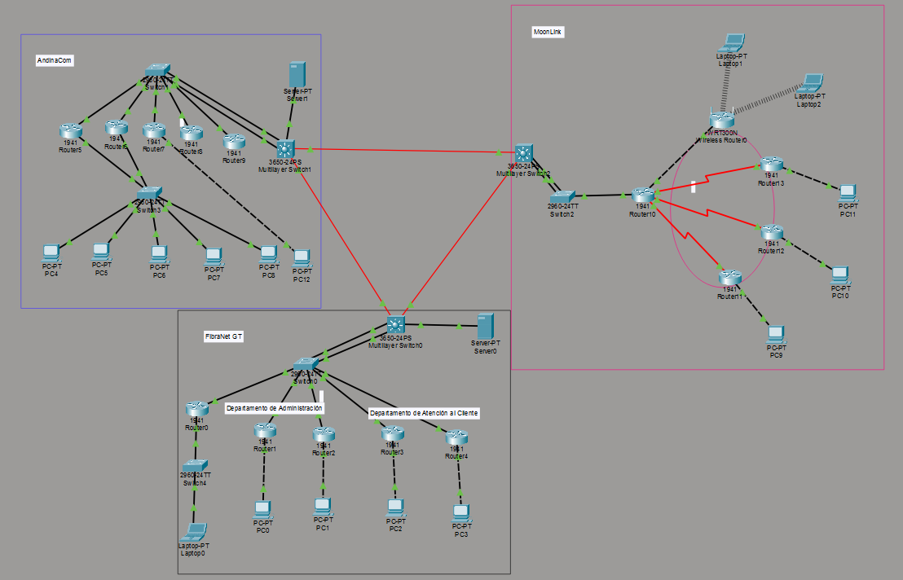
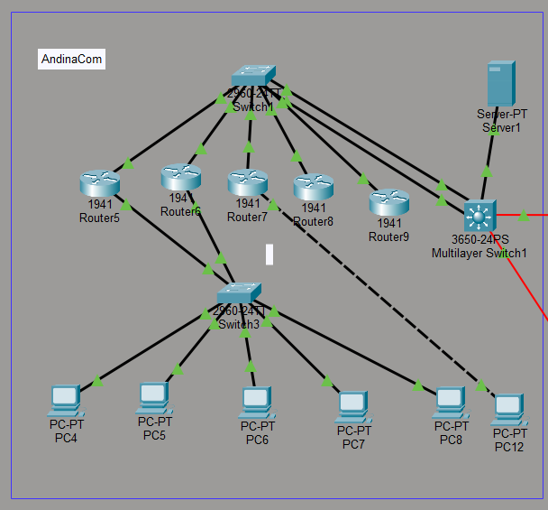
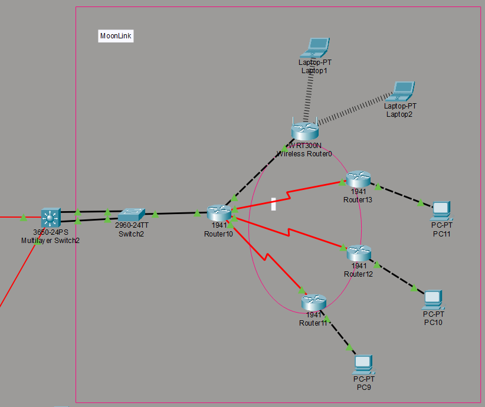
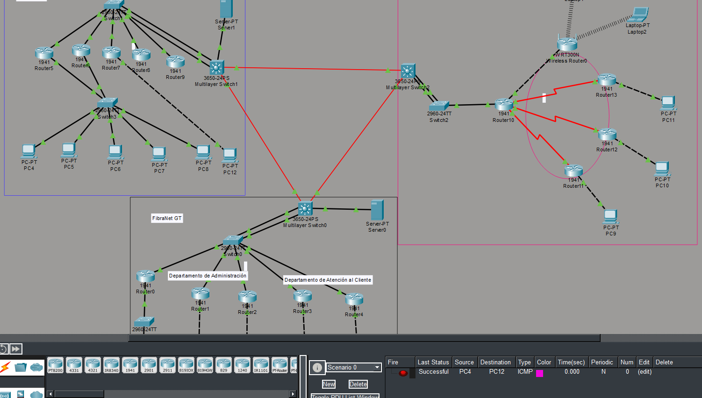
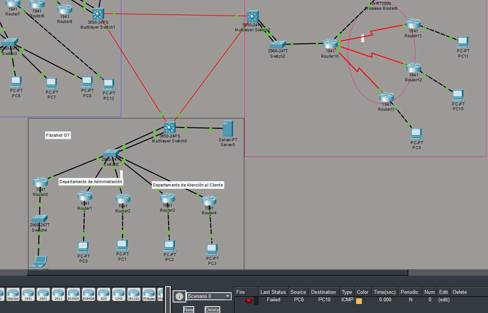
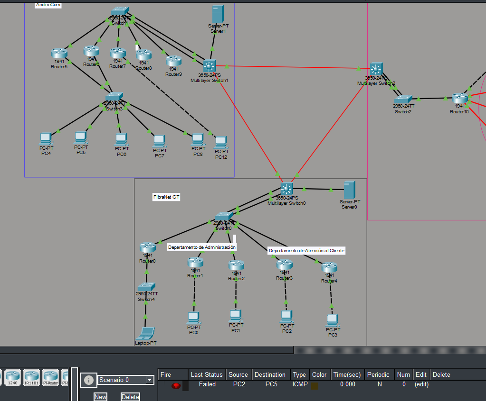
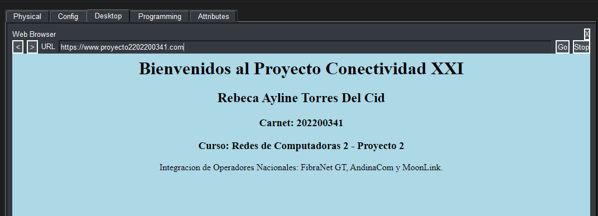
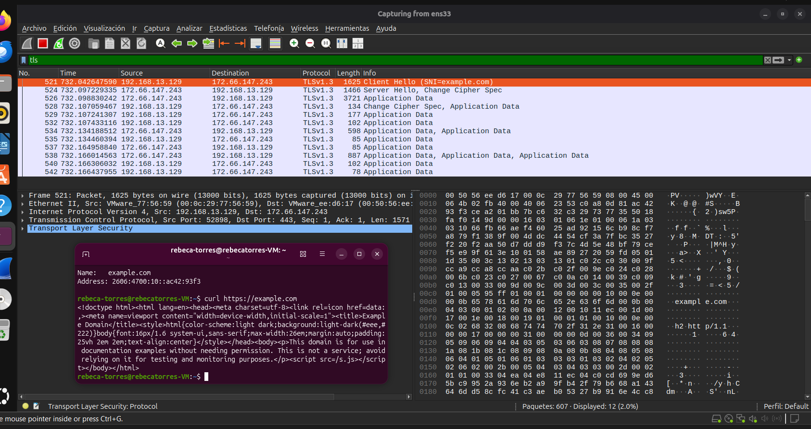

# Manual Técnico - Proyecto 2 - Conectividad XXI
**Curso:** Redes de Computadoras 2  
**Estudiante:** Rebeca Ayline Torres Del Cid  
**Carné:** 202200341  

---

## 1. Topologías de Red (Diagramas)

### 1.1 Topología Global

*Topología global con interconexión BGP*

### 1.2 ISP 1: FibraNet GT (Topología en Árbol)


### 1.3 ISP 2: AndinaCom (Topología Jerárquica)


### 1.4 ISP 3: MoonLink (Topología Hub-and-Spoke)


---

## 2. Direccionamiento y Subneteo

De acuerdo con las instrucciones del proyecto y el número de carné (202200341), las redes asignadas son:
*   **Red de interconexión BGP:** 192.168.41.0 /16 *(donde 41 son los últimos dos dígitos del carné)*.
*   **ISP 1 (FibraNet GT):** 172.16.11.0 /24 *(donde 1 es el último dígito del carné)*.
*   **ISP 2 (AndinaCom):** 172.16.21.0 /24 *(donde 1 es el último dígito del carné)*.
*   **ISP 3 (MoonLink):** 172.16.32.0 /24 *(donde 2 es el primer dígito del carné)*.

### 2.1 Subneteo BGP (Enlaces WAN /30)
| Enlace | Dirección de Subred | Máscara | Rango Utilizable |
| :--- | :--- | :--- | :--- |
| FibraNet GT <-> AndinaCom | 192.168.41.0 | 255.255.255.252 (/30) | 192.168.41.1 - 192.168.41.2 |
| AndinaCom <-> MoonLink | 192.168.41.4 | 255.255.255.252 (/30) | 192.168.41.5 - 192.168.41.6 |
| MoonLink <-> FibraNet GT | 192.168.41.8 | 255.255.255.252 (/30) | 192.168.41.9 - 192.168.41.10 |

### 2.2 Subneteo ISP 1: FibraNet GT (75 hosts por subred)
Se requiere acomodar 75 hosts, por lo tanto, se utiliza la fórmula $2^7 - 2 = 126$ hosts utilizables. Máscara de subred adaptada: /25.

| Departamento | Dirección de Subred | Máscara | Puerta de Enlace (Gateway) | Rango de Hosts |
| :--- | :--- | :--- | :--- | :--- |
| Administración | 172.16.11.0 | 255.255.255.128 (/25) | 172.16.11.1 | 172.16.11.2 - 172.16.11.126 |
| Atención al Cliente | 172.16.11.128 | 255.255.255.128 (/25) | 172.16.11.129 | 172.16.11.130 - 172.16.11.254 |

### 2.3 Subneteo ISP 2: AndinaCom (A discreción, se usará /25)
| Departamento | Dirección de Subred | Máscara | Puerta de Enlace (Gateway HSRP) | Rango de Hosts |
| :--- | :--- | :--- | :--- | :--- |
| Ventas | 172.16.21.0 | 255.255.255.128 (/25) | 172.16.21.1 | 172.16.21.2 - 172.16.21.126 |
| Facturación | 172.16.21.128 | 255.255.255.128 (/25) | 172.16.21.129 | 172.16.21.130 - 172.16.21.254 |

### 2.4 Subneteo ISP 3: MoonLink (45 hosts por subred)
Se requiere acomodar 45 hosts, por lo tanto, se utiliza la fórmula $2^6 - 2 = 62$ hosts utilizables. Máscara de subred adaptada: /26.

| Departamento | Dirección de Subred | Máscara | Puerta de Enlace (Gateway) | Rango de Hosts |
| :--- | :--- | :--- | :--- | :--- |
| Soporte | 172.16.32.0 | 255.255.255.192 (/26) | 172.16.32.1 | 172.16.32.2 - 172.16.32.62 |
| Seguridad | 172.16.32.64 | 255.255.255.192 (/26) | 172.16.32.65 | 172.16.32.66 - 172.16.32.126 |

---

## 3. Configuraciones Relevantes por ISP

### 3.1 BGP (Interconexión Global)
Se configuró BGP en los routers de borde de los tres ISPs para compartir la red 192.168.41.0/16 y sus respectivas redes LAN.
```bash
! Ejemplo Configuración Router Borde FibraNet GT
router bgp 100
 bgp log-neighbor-changes
 network 172.16.11.0 mask 255.255.255.0
 network 192.168.41.0 mask 255.255.255.252
 neighbor 192.168.41.2 remote-as 200
 neighbor 192.168.41.10 remote-as 300
```

### 3.2 HSRP (AndinaCom)
Se implementó el protocolo HSRP (Standby) en las interfaces LAN de AndinaCom para garantizar redundancia Gateway ante fallos del router principal.
```bash
! Ejemplo Configuración HSRP Interfaz Ventas (Router Principal)
interface GigabitEthernet0/0
 ip address 172.16.21.2 255.255.255.128
 standby 1 ip 172.16.21.1
 standby 1 priority 110
 standby 1 preempt
```

### 3.3 DHCP Centralizado y Helper Address (AndinaCom)
AndinaCom proporciona el servicio DHCP. En los routers de los otros ISPs, se configuró `ip helper-address` apuntando al servidor DHCP (Ej: 172.16.21.10).
```bash
! Configuración Helper-Address en FibraNet GT
interface GigabitEthernet0/1
 ip helper-address 172.16.21.10
```

---

## 4. Listas de Control de Acceso (ACLs)

Las ACLs se utilizaron para restringir el tráfico interdepartamental según la rúbrica.

**Justificación de Implementación:** Las listas de control de acceso extendidas (100-199) se implementaron lo más cerca posible del origen del tráfico (Inbound en la interfaz LAN). Esto es una mejor práctica que evita que el tráfico no deseado viaje por la red WAN antes de ser descartado, ahorrando ancho de banda.

**Ejemplo ACL Seguridad:**
*El departamento de Seguridad (MoonLink) puede iniciar ping a cualquier depto, pero nadie puede hacer ping hacia Seguridad.*
```bash
! En el router de MoonLink, interfaz LAN de Seguridad (Inbound)
access-list 101 permit icmp 172.16.32.64 0.0.0.63 any echo
access-list 101 permit tcp 172.16.32.64 0.0.0.63 any eq 80
access-list 101 permit tcp 172.16.32.64 0.0.0.63 any eq 443
access-list 101 deny ip any any
```

---

## 5. Pruebas de Conectividad (Ping y HTTP)

### 5.1 Prueba: Seguridad a Cualquier Depto (Exitoso)


### 5.2 Prueba: Cualquier Depto a Seguridad (Bloqueado)


### 5.3 Prueba: Facturación a Atención al Cliente (Bloqueado)


### 5.4 Prueba: Servicio DNS y HTTP

*Navegador web accediendo a www.proyecto2_202200341.com*

---

## 6. Análisis de Tráfico (Wireshark)

El tráfico fue capturado desde una máquina virtual Ubuntu en modo NAT para garantizar aislamiento y evitar tráfico del anfitrión. Archivo adjunto: `captura_wireshark_202200341.pcapng`.

### 6.1 Análisis Protocolo TCP (Three-Way Handshake)
Al solicitar la página por HTTP, se capturó la inicialización de la conexión.
*   **Capa 2 (Enlace de datos):** Trama Ethernet II con direcciones MAC de origen (VM) y destino (Gateway virtual).
*   **Capa 3 (Red):** Paquete IPv4, identificando la IP local de la VM hacia la IP pública del servidor web.
*   **Capa 4 (Transporte):** Se observan los 3 paquetes fundamentales:
    1.  **SYN:** El cliente solicita iniciar conexión (Seq=0).
    2.  **SYN-ACK:** El servidor acusa recibo y envía su sincronización (Seq=0, Ack=1).
    3.  **ACK:** El cliente confirma la recepción y la conexión queda establecida (Seq=1, Ack=1).


### 6.2 Análisis Protocolo DNS
Consulta ejecutada hacia el servidor público de Google (8.8.8.8) para `example.com`.
*   **Capa 3 (Red):** IP origen (VM) hacia IP destino `8.8.8.8`.
*   **Capa 4 (Transporte):** Protocolo UDP, puerto destino 53 (estándar DNS). No requiere establecer conexión previa, a diferencia de TCP.
*   **Capa 7 (Aplicación):** En el paquete de respuesta (Standard query response), se despliega el registro tipo A (Type: A) que traduce el dominio a la IPv4 `104.20.23.154`, y se especifica el "Time to Live" (TTL).


### 6.3 Análisis Protocolo TLS (HTTPS)
Conexión segura hacia el servidor web, demostrando las ventajas sobre HTTP plano.
*   **Capa 4 (Transporte):** Se establece primero el Three-way Handshake en el puerto 443.
*   **Capa 7 (Aplicación - TLSv1.3):** Se realiza el saludo seguro.
    *   **Client Hello:** El navegador de la VM envía los suites de cifrado soportados.
    *   **Server Hello:** El servidor responde acordando el cifrado.
    *   **Application Data:** A partir de aquí, en lugar de ver el contenido en texto plano (como con el filtro HTTP anterior), Wireshark muestra la carga útil (payload) de los paquetes como datos ilegibles y cifrados, protegiendo la información.



---